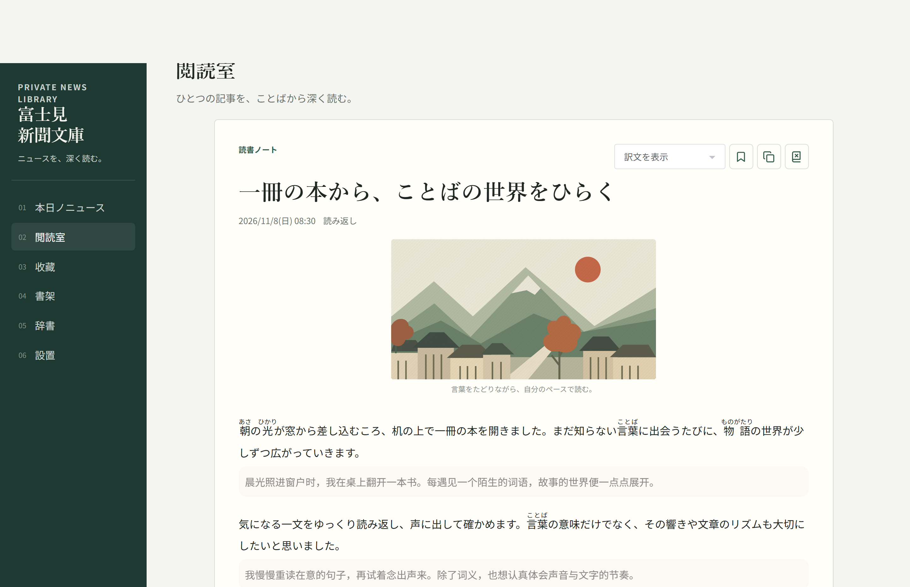
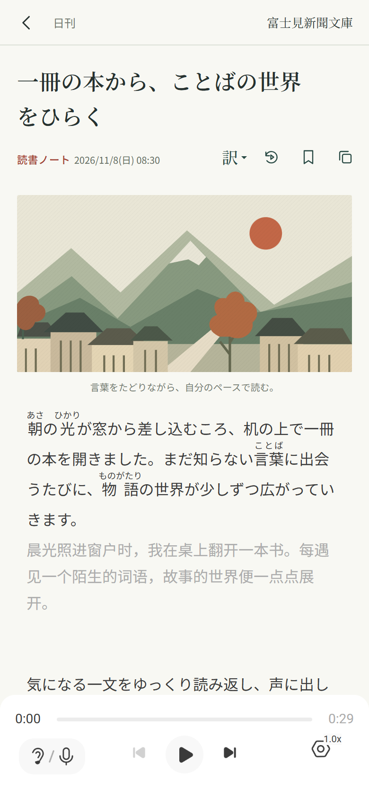
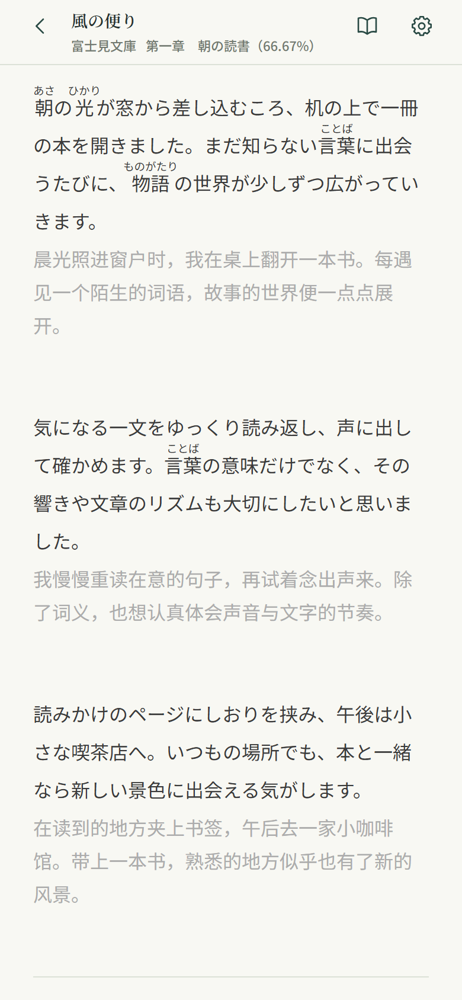
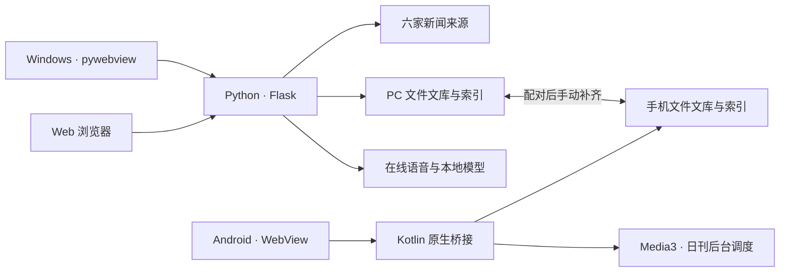

<p align="center">
  
</p>

<h1 align="center">富士見新聞文庫</h1>

<p align="center">
  <strong>ニュースを、深く読む。</strong><br>
  把日语新闻、电子书、词典与朗读，放进自己的文库。
</p>

<p align="center">
  <a href="https://github.com/TokisakaReijiKun/fujimi-news-bunko/releases/latest"></a>
  
  
  
</p>

<p align="center">
  <a href="#下载安装">下载安装</a> ·
  <a href="#界面预览">界面预览</a> ·
  <a href="#功能一览">功能一览</a> ·
  <a href="#快速开始">快速开始</a> ·
  <a href="#项目架构">项目架构</a> ·
  <a href="#文档导航">文档</a>
</p>

---

**富士見新聞文庫**是一款本地优先的日语新闻与电子书阅读应用，提供 **Windows 桌面端、Android 客户端和 Web 服务**。

它把日常阅读中的几个环节连在一起：从六家媒体整理日刊，导入文章与 EPUB，结合假名和中文译文阅读，在正文中查词，再把喜欢的内容保存为可以反复阅读、听读的个人文库。电脑与手机通过局域网或 Tailscale 配对，补齐书籍、文章、插图和已生成音频。

内容按文章和书籍保存为本地文件，阅读器、词典与音频围绕同一份文库工作。已经保存的正文、词典和本地附件可以离线使用；采集、在线翻译及在线声线按需联网。

## 下载安装

当前正式版本：**[1.1.28](https://github.com/TokisakaReijiKun/fujimi-news-bunko/releases/tag/v1.1.28)**。整个项目统一发布 Windows、Android 和含词典的源码包。

| 使用方式 | 下载 | 运行要求 |
| --- | --- | --- |
| **Windows 桌面端** | [下载 Windows x64 便携包](https://github.com/TokisakaReijiKun/fujimi-news-bunko/releases/download/v1.1.28/FujimiShinbunBunko-1.1.28-windows-x64.zip) | Windows x64、Microsoft Edge WebView2 Runtime；普通运行无需另装 Python |
| **Android 客户端** | [下载 Android APK](https://github.com/TokisakaReijiKun/fujimi-news-bunko/releases/download/v1.1.28/FujimiShinbunBunkoAndroid-1.1.28-release.apk) | Android 10 及以上；可覆盖安装已有正式版 |
| **Web／自行构建** | [下载含词典的项目源码包](https://github.com/TokisakaReijiKun/fujimi-news-bunko/releases/download/v1.1.28/FujimiShinbunBunko-1.1.28-source.zip) | conda Tokyo、Python 3.10；构建 Android 另需 Android SDK 与 Gradle |

Windows 用户解压后运行 `FujimiShinbunBunko.exe`，保留同目录的 `_internal/`。Android 首次启动按系统提示授予文库存储权限。

源码发行包已附带只读词典。直接 `git clone` 或下载 GitHub 自动生成的 Source code 归档时，需要另从源码发行包取出 `apk-original/dictionary/dictionary.sqlite3`。

发行包不包含个人文库、密钥或 TTS 模型。[查看所有版本与更新说明 →](https://github.com/TokisakaReijiKun/fujimi-news-bunko/releases)

## 界面预览

以下使用当前正式前端和示例内容截图，展示桌面布局、手机日刊、双语阅读与 EPUB 阅读。

### 桌面阅读



<table>
  <tr>
    <th align="center">手机日刊</th>
    <th align="center">文章阅读</th>
    <th align="center">电子书阅读</th>
  </tr>
  <tr>
    <td width="33%"></td>
    <td width="33%"></td>
    <td width="33%"></td>
  </tr>
</table>

## 功能一览

| | 可以做什么 |
| --- | --- |
| **每日新闻** | 汇集 NHK、朝日、读卖、日经、产经和 Yahoo! 新闻；按来源配额生成日刊，支持手动更新、CST 定时与历史日期回看 |
| **文章阅读** | 网址导入、粘贴日文、保存阅读示例；显示假名、中日对照或按需展开译文，收藏文章并保留本地附件 |
| **EPUB 书架** | PC 导入 EPUB，保留目录、插图、ruby 与书籍自带译文；支持章节跳转、横排／纵排、阅读进度和书签，手机可同步后阅读 |
| **日中词典** | 内置 **159,396** 词，支持日语、假名、常见罗马字与中文释义检索；提供释义、例句及朗读，手机支持新闻和电子书点词查词、收藏词条 |
| **朗读与声线** | 系统语音、圭太／七海在线声线，以及按环境配置的 Kokoro、VOICEVOX、Irodori；支持音频保存、播放、倍速与段落定位 |
| **设备互连** | PC 与 Android 扫码配对，通过局域网或 Tailscale 手动双向补齐内容；传输书籍、文章、图片、完整音频与参考声线 |

### 从一篇新闻，到一段自己的阅读时间

**收集内容。** 六家来源分别处理候选、公开正文、分页和媒体。日刊先验证候选，再按配额选择，最后处理入选文章；会员门槛、无效页面和失败任务会如实反馈。阅读室也可以导入单篇网址，或保存自己的日文文章。

**读懂正文。** 新闻和电子书都可以围绕原文、假名、译文与词典阅读。书籍按 EPUB 的正式目录和阅读顺序组织，保留图片与明确标记的双语内容；手机点词查词覆盖新闻和电子书。

**保存并重读。** 收藏文章、收藏词条、书签和已保存音频构成日常阅读积累。文章正文、译文、资源和音频留在本机，不必每次重新获取。

### 新闻来源

[NHKニュース](https://news.web.nhk/newsweb/) · [朝日新聞](https://www.asahi.com/) · [読売新聞](https://www.yomiuri.co.jp/) · [日本経済新聞](https://www.nikkei.com/) · [産経新聞](https://www.sankei.com/) · [Yahoo!ニュース](https://news.yahoo.co.jp/)

各来源独立维护采集与解析规则。来源是否可达、文章是否公开、媒体能否保存是不同状态；视频只能预览时会保留真实状态。日经标题含「【企業一覧】」的企业名单汇总文章不进入采集与导入流程。

## 三端能力

| 能力 | Windows／Web | Android |
| --- | --- | --- |
| 独立采集日刊与翻译 | 支持；翻译需配置密钥 | 支持；翻译需配置密钥 |
| 新闻阅读、假名与中日对照 | 支持 | 支持 |
| EPUB 导入 | 支持 | 通过 PC 导入后同步 |
| EPUB 阅读、目录、进度与书签 | 支持 | 支持已同步书籍 |
| 阅读中查词 | 选词查词 | 点词查词，覆盖新闻与 EPUB |
| 圭太／七海在线朗读 | 支持 | 支持，可保存音频后离线播放 |
| 本地模型合成 | 取决于模型和运行环境 | 请求已配对 PC 合成，接收完整音频 |
| 文库补齐 | 与 Android 配对 | 与 PC 配对 |

Windows 与 Web 共用服务和存储层，桌面端另外提供窗口、托盘及桌面声线。Android 使用本机文库、原生播放与后台调度，可以独立获取日刊；本地模型推理由 PC 承担。

## 快速开始

### 1. 准备源码与词典

可以直接解压上面的**含词典源码包**，进入项目目录。通过 Git 获取源码时执行：

```powershell
git clone https://github.com/TokisakaReijiKun/fujimi-news-bunko.git
cd fujimi-news-bunko
```

确认 `apk-original/dictionary/dictionary.sqlite3` 已放好。原词典只读使用，首次查询会创建独立的本地搜索索引。

### 2. 启动 Web 服务

下面以新建环境为例；已有 Tokyo 环境时跳过第一行。

```powershell
conda create -n Tokyo python=3.10
conda run -n Tokyo python -m pip install -r requirements.txt
conda run --no-capture-output -n Tokyo python -X utf8 server.py
```

浏览器访问 **http://127.0.0.1:8427**。Windows 下也可使用：

```powershell
./start.ps1
```

### 3. 启动源码桌面端

```powershell
conda run -n Tokyo python -m pip install -r requirements-desktop.txt
./start-desktop.ps1
```

桌面服务默认使用 **http://127.0.0.1:8428**。关闭窗口会隐藏到托盘，托盘菜单的“退出”才会停止服务。定时任务需要服务保持运行。

### 可选：启用翻译与模型朗读

翻译在本机 `.env` 中配置，或通过进程环境变量提供：

```dotenv
DEEPSEEK_API_KEY=your_api_key
```

`DEEPSEEK_MODEL` 可指定模型；未配置密钥时，不发起翻译请求。翻译会把待处理正文发送给所配置的服务，可能产生 API 费用。Android 在设置页单独配置密钥，密钥不随文库同步。

| 朗读方式 | 条件与用途 |
| --- | --- |
| 系统语音 | 使用当前设备可用的日语声线，即时朗读 |
| 圭太／七海 | 使用在线语音服务；完整音频保存后可以离线播放 |
| Kokoro／VOICEVOX | PC 准备对应模型和运行库后提供本地朗读，模型资源不随发行包提供 |
| Irodori | PC 准备 Tokyo 推理环境、模型与参考音频；按文章或章节生成并保存完整音频 |

具体配置见 [朗读与模型](docs/tts.md)、[Windows 客户端](docs/desktop-client.md) 和 [手机请求 PC 合成](docs/android-1.1.22-pc-speech.md)。

## 设备互连

1. 在 PC 设置中开启 **文庫互联**，保持服务运行。
2. Android 扫描 PC 显示的二维码，或输入连接地址与六位配对码。
3. 配对成功后执行同步，补齐另一端缺少的文章、书籍、插图、音频和参考声线。

已安装 Tailscale 时，应用可启动客户端并请求连接；首次登录和系统 VPN 授权仍由用户完成。同一局域网内也可直接配对使用。

同步采用**手动双向补齐**：两端保留各自文库，按实体内的相对路径和文件大小决定附件是否需要传输。本机阅读进度独立保留，删除与最新编辑操作不会自动传播。它适合把电脑整理的内容带到手机，再把手机新增内容带回电脑。

管理页面默认只监听本机；开启互连后，配对与传输使用选定的局域网或 Tailscale 地址，默认端口 `8429`。PC 服务重启后需要重新配对。完整范围与连接说明见 [设备同步](docs/device-sync.md)。

## 项目架构

Windows 与 Web 使用同一套应用服务，Android 通过原生桥接连接手机存储、播放和调度能力。前端为原生 HTML／CSS／JavaScript，**没有 npm 构建步骤**。



| 层次 | 主要技术与职责 |
| --- | --- |
| 页面与阅读器 | 原生 JavaScript、CSS、WebView，新闻与 EPUB 阅读、词典、播放器 |
| Web／桌面服务 | Python、Flask、pywebview、pystray，API、窗口、托盘与任务管理 |
| Android | Kotlin、AndroidX WebKit、Media3、WorkManager、Kuromoji，原生接口、音频、调度与离线假名 |
| 内容存储 | 按文章与书籍组织的文件文库；SQLite 保存索引与设置 |
| 新闻处理 | 来源独立的采集、解析、翻译、假名与媒体保存 |
| 朗读 | 系统语音、Edge 在线声线与可选的 Kokoro／VOICEVOX／Irodori 后端 |

### 目录结构

```text
├── server.py                Web API、任务与服务装配
├── desktop.py               Windows 窗口、托盘与运行环境
├── news_providers/          六家来源各自的采集与解析
├── article_store.py         新闻文件存储
├── book_store.py            书籍文件存储
├── epub_parser.py           EPUB 目录、章节与资源解析
├── library_sync.py          文库补齐与内容传输
├── device_sync.py           配对、互连服务与手机请求入口
├── tts_service.py           声线、朗读队列与推理进程管理
├── static/                  正式页面、阅读器与手机前端
├── android/                 Android 客户端与核心存储实现
├── apk-original/dictionary/  只读词典资源
├── Irodori-TTS/             本地模型项目代码
├── docs/                    架构、配置与子系统说明
└── tests/                   回归测试与隔离样本
```

<details>
<summary><strong>本地文库如何组织</strong></summary>

正文与书籍以文件为事实来源；SQLite 保存可重建的内容索引及应用设置。

```text
data/
├── articles/YYYY-MM-DD/标题/  正文、译文、假名、媒体与音频
├── bookmarks/标题/            收藏文章的完整副本
├── books/书名/                原 EPUB、目录、章节、资源、进度与音频
├── voices/                    参考声线
├── fujimi.sqlite3             内容索引与设置
└── dictionary-search.sqlite3  词典搜索索引
```

Windows 便携版默认使用 `%LOCALAPPDATA%/FujimiShinbunBunko/data/`；源码版默认使用项目 `data/`，可由 `FUJIMI_DATA_DIR` 指定。Android 文库位于内部存储的 `富士見新聞文庫/data/`，密钥等私有配置单独保存。

文件布局、索引恢复与迁移说明见 [新闻存储](docs/article-storage.md) 和 [书架与 EPUB](docs/book-reader.md)。

</details>

## 文档导航

| 主题 | 文档 |
| --- | --- |
| Windows 启动、打包与数据目录 | [Windows 桌面客户端](docs/desktop-client.md) |
| Android 构建、安装与本机能力 | [Android 客户端](docs/android-client.md) |
| 局域网／Tailscale 配对与同步范围 | [设备同步](docs/device-sync.md) |
| 新闻来源与独立处理流程 | [分来源新闻处理](docs/news-providers.md) |
| EPUB 目录、阅读模式与书架存储 | [书架与 EPUB 阅读器](docs/book-reader.md) |
| 本地模型、参考声线与音频保存 | [朗读系统](docs/tts.md) |
| 文章文件、索引与恢复工具 | [新闻存储](docs/article-storage.md) |
| 阅读室例文的保存与复用 | [阅读示例](docs/reading-examples.md) |
| 手机发起 PC 音频合成 | [跨设备朗读](docs/android-1.1.22-pc-speech.md) |

## 参与项目

欢迎提交可复现的问题、文档改进和代码贡献。

- **反馈问题**：在 [Issues](https://github.com/TokisakaReijiKun/fujimi-news-bunko/issues) 说明版本、运行平台、操作步骤和实际结果。采集问题请附文章网址；提交日志前移除密钥与个人信息。
- **提交改动**：通过 [Pull Request](https://github.com/TokisakaReijiKun/fujimi-news-bunko/pulls) 描述具体问题、修改后的行为和验证方式。新闻来源保持独立，手机样式与桌面行为分别处理。
- **开发约定**：参见 [AGENTS.md](AGENTS.md)。测试与修复使用临时文库，避免改写个人内容。

<details>
<summary><strong>构建与开发检查</strong></summary>

Windows 打包：

```powershell
conda run -n Tokyo python -m pip install -r requirements-desktop.txt
./build-desktop.ps1 -Version dev
```

Android 构建需要 Android SDK Platform 36、Build Tools 36.0.0 与 Gradle 9.6：

```powershell
./build-android.ps1
```

发布签名配置和 Release 构建说明见 [Android 文档](docs/android-client.md)。

Python 与前端的常用检查：

```powershell
conda run -n Tokyo python -X utf8 -m unittest discover -s tests -v
node --check static/main.js
node --check static/book-reader.js
node --check static/browser-speech.js
```

前端无需 npm 安装或打包，Node 用于 JavaScript 语法检查。具体子系统的检查范围见开发约定。

</details>

## 致谢

项目基于 Flask、pywebview、pystray、SQLite、pykakasi、Kuromoji、AndroidX WebKit 和 Media3 等组件构建，朗读能力接入 Edge 在线语音、Kokoro、VOICEVOX 与 Irodori-TTS。

第三方组件的许可信息随对应项目保留，参见 [Irodori-TTS 许可证](Irodori-TTS/LICENSE) 与 [edge-tts 许可说明](android/core/src/main/resources/META-INF/edge-tts-LICENSE.txt)。新闻、书籍与模型资源分别遵循各自的使用条件。

---

<p align="center"><strong>富士見新聞文庫</strong> · ニュースを、深く読む。</p>
